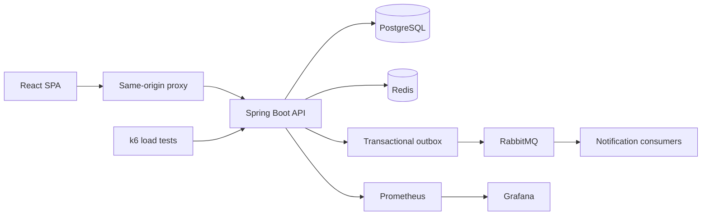

# TicketRush

**A high-load ticket booking platform built to explore correctness under contention.**

TicketRush is a portfolio project for flash-sale ticketing. Its central engineering goal is to preserve inventory and payment correctness when many buyers compete, then measure the system with reproducible load tests. The repository includes a Java/Spring backend, a React/TypeScript customer and operations UI, local infrastructure, integration tests, and a documented performance laboratory.

> **Project status:** Core booking, payment, waiting-room, and reserved-seat flows are implemented. A bounded 5,000-entry sell-out experiment is documented. This is a development/demo system: it does not integrate a real payment provider and its measurements are not production capacity claims.

## Highlights

- **Inventory safety:** PostgreSQL is authoritative for inventory. Conditional updates, transaction boundaries, and uniqueness constraints protect booking state under concurrent requests.
- **Idempotent checkout:** Idempotency keys, signed payment webhooks, and deduplication prevent retries from creating duplicate orders or applying a payment twice.
- **Reservation lifecycle:** Reservations expire and release inventory through guarded state transitions; tests exercise expiry and concurrent behavior against real services.
- **Reliable event delivery:** A transactional outbox records business events alongside database changes, with RabbitMQ delivery and idempotent consumers.
- **Flash-sale admission:** An optional Redis gate and per-event waiting room control admission before requests reach PostgreSQL. The default reservation strategy remains the database conditional-update path.
- **Reserved seating:** The backend supports seat inventory alongside general-admission ticket tiers. The frontend includes event discovery, checkout, user ticket wallet, staff gate tools, and admin workflows.
- **Measured performance:** The repository contains k6 scenarios, telemetry dashboards, correctness verification, raw results, and documented limitations.

## Architecture

TicketRush is a modular monolith. Backend modules are organized around business capabilities and communicate through service interfaces or domain events. PostgreSQL remains the source of truth; Redis is used for admission, queue coordination, cache, and rate limiting; RabbitMQ carries asynchronous notifications and outbox events.



### Technology

| Area | Stack |
| --- | --- |
| Backend | Java 21, Spring Boot, Spring Security, Spring Data JPA, Flyway |
| Frontend | React 19, TypeScript, Vite |
| Data and messaging | PostgreSQL, Redis, RabbitMQ |
| Testing and performance | JUnit 5, Testcontainers, Playwright, k6 |
| Local operations | Docker Compose, Prometheus, Grafana |

## Performance evidence

The final bounded sell-out run used a FIFO cohort of 5,000 entries and 20 offered admission/checkout opportunities per second. It sold exactly 5,000 tickets, ended with zero available or held inventory, recorded no oversell, and accounted for every user as `PAID` or `SOLD_OUT`.

This is one bounded run, not 5,000 simultaneous purchases or 20 paid orders per second. It was not repeated three times, and higher-rate calibration was not completed. The methodology, artifacts, and caveats are in the [performance report](docs/performance/README.md#final-bounded-result-2026-10-18) and [experiment log](docs/performance/log.md).

## Run locally

### Prerequisites

- Docker Engine / Docker Desktop with Docker Compose
- JDK 21 and Maven (for host-side backend development)
- Node.js and npm (for frontend development)

Copy `.env.example` to `.env` and provide independent values for the required secrets. Do not commit `.env`.

```sh
docker compose up --build --wait --wait-timeout 240
```

The API is available at `http://localhost:8080`; Swagger UI is at `http://localhost:8080/swagger-ui.html`. For the frontend, in a separate terminal:

```sh
npm --prefix frontend ci
npm --prefix frontend run dev
```

Open `http://localhost:3000`. The frontend server proxies API requests to Spring Boot. See [deployment notes](docs/deploy-render.md) for the demo deployment setup and current hosting limits.

## Verify

Backend integration tests use Testcontainers with real PostgreSQL, Redis, and RabbitMQ services. Docker must be running.

```sh
mvn -B -ntp -f backend/pom.xml clean verify
npm --prefix frontend run lint
npm --prefix frontend test
npm --prefix frontend run build
```

To run the isolated performance laboratory, follow [its setup and run instructions](docs/performance/README.md). Do not interpret a single local benchmark as a production capacity guarantee.

## Repository map

```text
backend/          Spring Boot application and integration tests
frontend/         React SPA, same-origin proxy, and frontend tests
loadtest/         k6 scenarios and performance tooling
infrastructure/   Docker, monitoring, and local environment scripts
docs/             Architecture, API, design decisions, and test evidence
```

Useful references: [architecture](docs/architecture.md) · [API](docs/api.md) · [database model](docs/database.md) · [design decisions](docs/decisions/) · [performance lab](docs/performance/README.md)

## Current limitations

- Payments use a signed mock gateway; there is no real payment provider integration.
- The free demo deployment disables RabbitMQ delivery and email.
- Some profile and notification UI elements are illustrative and are not persisted by backend APIs.
- Performance results are bounded experiments on a single development setup, not production SLOs.

These limitations and the scope of implemented flows are detailed in the [deployment notes](docs/deploy-render.md) and performance documentation.
