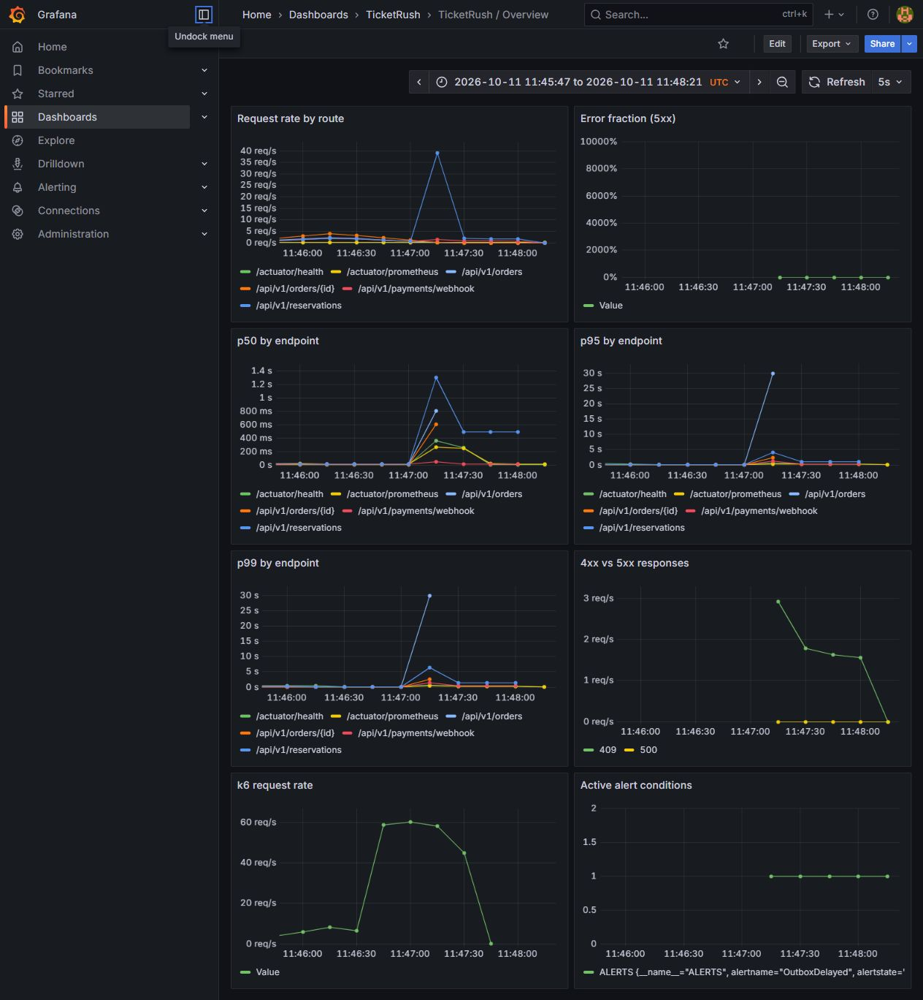

# TicketRush performance laboratory

The baseline does **not** meet the 5,000-user flash-sale target. It recorded 97.6% failed
HTTP responses, only 131 PAID orders and 332 valid tickets from 5,000 offered users, and
five-second timeouts. It is retained as a negative result, but it and `final-C-1..3` have no
per-run provenance record. They are indicative only and are not used as evidence for the
attribution below.

The subsequent stress run `stress-1` preserved every checked invariant after drain, including
zero oversell, zero pending outbox records and exactly one sent confirmation for each of 5,357
paid orders. It still failed performance thresholds: 4,649 dropped arrivals, 2.4867% failed
HTTP requests, reserve p95 5,000.32 ms and order p95 2,842.43 ms. Its low-load recovery p95
was 185.18 ms. This measures an overload knee and recovery behavior, not sustainable capacity;
the [summary](results/stress-1.json), [verifier](results/stress-1-verify.json), and
[JFR summary](results/stress-1-jfr-summary.txt) are retained.

The 20-minute `soak-1` workload passed on this shared laptop VM: 24.08 HTTP RPS, zero dropped
iterations, zero unexpected responses/5xx, reserve p95 33.66 ms and order p95 45.88 ms. After
drain it retained zero oversell, no pending/failed outbox events and exactly one confirmation
for each paid order. Read this as a one-run sustained-load observation; the
[summary](results/soak-1.json) and [verifier](results/soak-1-verify.json) retain the evidence.

## Interleaved attribution: final hot-row write

Scenario C offers 5,000 arrivals at 250/s for 20 seconds. The primary outcome is server-side:
PAID is verifier `paid_orders - 121` warm-up orders; served fraction is `(PAID + SOLD_OUT) / 5,000`.
All six runs below have provenance, a k6 summary, telemetry, and a completed verifier. k6 threshold
exit 99 is expected for an overload result and does not invalidate a run whose verifier passes.

| Run | commit | started | dropped | PAID (server) | SOLD_OUT | served | RPS | reserve p95 | order p95 | verifier |
| --- | --- | ---: | ---: | ---: | ---: | ---: | ---: | ---: | ---: | --- |
| attribution-C-1 | e29ce4f | 1,216 | 3,784 | 105 | 0 | 2.1% | 59.7 | 5,149.0 ms | 5,148.4 ms | PASS |
| final-C-4 | post-7eef / 174aac3 | 921 | 4,080 | 491 | 0 | 9.8% | 197.5 | 6,780.0 ms | 6,713.1 ms | PASS |
| attribution-C-2 | e29ce4f | 840 | 4,577 | 689 | 0 | 13.8% | 279.4 | 3,129.5 ms | 5,017.8 ms | PASS |
| final-C-5 | HEAD / 5bda52c | 1,218 | 3,783 | 672 | 0 | 13.4% | 281.7 | 5,034.3 ms | 5,542.3 ms | PASS |
| attribution-C-3 | e29ce4f | 1,168 | 3,832 | 988 | 0 | 19.8% | 677.2 | 3,272.3 ms | 3,266.8 ms | PASS |
| final-C-6 | HEAD / 5bda52c | 1,209 | 3,790 | 1,024 | 0 | 20.5% | 690.0 | 1,939.5 ms | 1,779.5 ms | PASS |

| Commit, n=3 | started median (range) | dropped median (range) | PAID median (range) | served median (range) | RPS median (range) | reserve p95 median (range) | order p95 median (range) |
| --- | ---: | ---: | ---: | ---: | ---: | ---: | ---: |
| e29ce4f | 1,168 (840–1,216) | 3,832 (3,784–4,577) | 689 (105–988) | 13.8% (2.1–19.8%) | 279.4 (59.7–677.2) | 3,272.3 ms (3,129.5–5,149.0) | 5,017.8 ms (3,266.8–5,148.4) |
| post-7eef HEAD series | 1,209 (921–1,218) | 3,790 (3,783–4,080) | 672 (491–1,024) | 13.4% (9.8–20.5%) | 281.7 (197.5–690.0) | 5,034.3 ms (1,939.5–6,780.0) | 5,542.3 ms (1,779.5–6,713.1) |

The isolated SQL capture proves the intended change, but the interleaved load medians and ranges
overlap heavily. Therefore the effect of `7eef8a6` on end-to-end Scenario C throughput or latency
does **not** exceed run-to-run noise on this shared generator/VM. It is not a capacity claim.
The earlier six-run sequence is not evidence of a monotonic wall-clock trend: the same-config A/A
control had large variance. Its raw triples are WAL sync / hot UPDATE mean / PAID / reserve p95:
`4.75 ms / 4.71 ms / 1,017 / 1,496.7 ms`, `5.62 / 10.05 / 1,067 / 1,805.7`, and
`12.88 / 118.74 / 551 / 5,001.1`; the last p95 is the five-second timeout cap. They are
consistent with, not proof of, a commit-latency hypothesis. The isolated trace is one cold request:
it proves statement order, not the magnitude of a load-test effect.
The raw artifacts are [C-1 provenance](results/attribution-C-1-provenanced-provenance.json),
[C-6 provenance](results/final-C-6-provenanced-provenance.json), and the two isolated PostgreSQL
captures: [e29](results/statement-order-e29-postgres.log), [HEAD](results/statement-order-head-postgres.log).

Baseline B's approximately 50 requests/s includes rate-limited responses from a shared
load-generator IP. Inspect `browse_ok` and `browse_limited` in [aggregate.json](results/aggregate.json)
before interpreting browse throughput. The existing limiter remains enabled.

## Evidence and correctness



The screenshot uses the stored C-1 time window. Backend scrape timeouts during saturation
create gaps: missing Hikari samples must not be interpreted as zero pending threads.
The [deep JFR profile](results/baseline-C-1-deep-profile.json) shows connection-acquisition
waits and PostgreSQL socket reads on the guarded inventory update. Its 1,302 calls took
83,438.41989299988 ms total in [pg_stat_statements](results/baseline-C-1-queries.json).

For C-1 after drain, all 205 tiers conserved inventory, 332 valid tickets matched confirmed
quantity, oversold was 0, and all 131 orders mapped to 131 distinct successful idempotency
effects. However, 4,498 outbox events remained pending and 0 of 131 paid orders had a sent
confirmation. Redis mismatches were reported before reconciliation and were 0 afterward.
See every count in the [verifier output](results/baseline-C-1-verify.json); this run failed.

The separate [build record](results/iteration1-build-tests.json) reports 98 passing Java
tests after the transaction optimization. Passing integration tests do not replace failed
end-to-end load verification. See the [experiment log](log.md) for failures and decisions.

## Environment and interpretation

- Intel Core i5-10500H, 6 physical / 12 logical cores; host RAM 8,403,070,976 bytes.
- Docker Desktop Linux VM: 12 CPUs and 4,013,400,064 bytes RAM. Generator and services share this VM.
- Java 21, Spring Boot 3.5.6, PostgreSQL 17, Redis 7.4, RabbitMQ 4.1; exact image IDs and runtime versions
  are in [environment.json](results/environment.json), [CPU](results/host-cpu.json), [RAM](results/host-ram.json).
- Hikari maximum 10, Tomcat maximum 200, platform threads, heap 256..768 MiB, conditional-update strategy.
- The isolated profile accelerates hold TTL to 60 seconds, expiry interval to 5 seconds, late grace to 5 seconds.
  It does not change the production defaults, inventory guards or durability settings.
- Default dataset: 20,000 buyers plus one admin, HOT (5,000 tickets), MIXED (three 100,000-ticket tiers),
  WARMUP (100,000 tickets), and 200 background events. JWTs last 24 hours and credentials are local/ignored.
- One minute of purchase warm-up precedes measurement, using a separate event and a separate user range.
  Warm-up purchases remain in the database; the verifier checks them too. HOT-only counts must be read
  from its tier row, not confused with aggregate counts that include warm-up.

## Reproduce

Requires Docker Compose supporting `!override`, Python 3 on the host, and enough disk for pinned images.
No host k6 or Python third-party packages are needed: tooling runs in its own image. On Windows replace
`python3` with `python`. Commands are run from the repository root.

```sh
python3 infrastructure/scripts/loadtest.py init
python3 infrastructure/scripts/loadtest.py up
python3 infrastructure/scripts/loadtest.py test
python3 infrastructure/scripts/loadtest.py environment
python3 infrastructure/scripts/loadtest.py seed --users 20000 --capacity 5000 --background 200

# Each run resets/reseeds, restarts backend counters, warms up, runs k6, and verifies automatically.
python3 infrastructure/scripts/loadtest.py run --scenario A --users 1200 --run-id smoke
python3 infrastructure/scripts/loadtest.py run --scenario B --run-id browse
python3 infrastructure/scripts/loadtest.py run --scenario C --run-id spike --jfr
python3 infrastructure/scripts/loadtest.py run --scenario D --run-id mixed
python3 infrastructure/scripts/loadtest.py run --scenario E --capacity 100000 --run-id stress --jfr
python3 infrastructure/scripts/loadtest.py run --scenario F --run-id login
python3 infrastructure/scripts/loadtest.py run --scenario G --run-id soak

# Examples of explicit workload parameters, preserved in run metadata:
python3 infrastructure/scripts/loadtest.py run --scenario C --run-id slower-spike --param SPIKE_SECONDS=30
python3 infrastructure/scripts/loadtest.py run --scenario C --run-id queued --waiting
python3 infrastructure/scripts/loadtest.py verify --drain 180
python3 infrastructure/scripts/loadtest.py queries --top 10
python3 infrastructure/scripts/loadtest.py reset
python3 infrastructure/scripts/prove-verifier.py
python3 infrastructure/scripts/loadtest.py down
```

`seed` refuses a nonempty database; `reset` stops backend workers and clears only the dedicated database,
`ticketrush:loadtest:*` Redis keys, project email queues and Mailpit. It never runs FLUSHALL. The runner
uses the fixed Compose project `ticketrush-week7`; do not run two invocations simultaneously.
The mutation proof uses a separate image and restores the standard image/constraint in `finally`.
It offers C's 5,000-user cohort with HOT capacity 100 so that guard removal is exercised
even on a host that drops arrivals; this mutation run is not a performance comparison.

A/B/F take approximately one minute of warm-up + one minute of measured traffic + startup/drain.
C/D add a 20-second spike (D has 50 seconds of background browsing). E uses five 30-second steps
and a one-minute recovery stage. G measures for 20 minutes. Verification allows up to three minutes
for asynchronous delivery; any remaining pending work fails. These are configured durations, not benchmark results.

Shortcut targets: `make loadtest-smoke`, `make loadtest-spike`, `make verify`, `make reset`.
The requested shell wrappers under `infrastructure/scripts/` invoke the same implementation.
CI runs A and verifier on each PR; B–G are explicit manual dispatches. H is optional and not yet executed.

## Observability

For an existing development stack, set independent `METRICS_PASSWORD` and `GRAFANA_PASSWORD` in `.env`:

```sh
docker compose --profile observability up --build
# Existing volumes need the extension once (new volumes create it automatically):
docker compose exec postgres sh -c 'psql -U "$POSTGRES_USER" -d "$POSTGRES_DB" -c "CREATE EXTENSION IF NOT EXISTS pg_stat_statements"'
```

The isolated runner exposes [Grafana](http://127.0.0.1:23007), [Prometheus](http://127.0.0.1:29097),
[API health](http://127.0.0.1:28087/actuator/health) and [Mailpit](http://127.0.0.1:28027).
Grafana uses `admin` and the generated password in `.tools/week7.env`. Do not publish that file or
`loadtest/.data`; only sanitized `docs/performance/results` files belong in artifacts.
Prometheus uses separate Basic scrape credentials; user JWTs cannot access the scrape endpoint.

Seven versioned dashboards cover HTTP, funnel, database, Redis, messaging, JVM/containers and waiting room.
HTTP histograms have route-template labels. No user/order/reservation/correlation identifier is a metric label.
Inventory uses eight stable slots (HOT first, then MIXED, then background tiers), avoiding a series per UUID.
Lettuce latency, Hikari, Tomcat, JVM and Rabbit metrics are collected; inactive waiting rooms legitimately
have no wait observations. JSON logs use ECS and HTTP correlation IDs in MDC. OpenTelemetry is explicitly
skipped for this milestone; JFR profiles provide CPU/blocking evidence without partial tracing setup.

cAdvisor 0.54.0 is required here because it supports Docker's containerd snapshotter
([upstream release](https://github.com/google/cadvisor/releases/tag/v0.54.0)). Five Prometheus alerts are
evaluated locally; no external notifier is configured. Slow SQL statements are logged at a configurable
`POSTGRES_SLOW_QUERY_MS` threshold; the dashboard's slow-fingerprint count uses mean >=250 ms and is
not a count of individual slow executions.

## Limitations

This is a single laptop-class machine with a shared load generator, synthetic users, a small dataset,
and an in-process mock gateway with a configured 500 ms delay. It does not establish production capacity,
internet latency, external payment-provider reliability, multi-node fairness or high availability.
One generator IP is subject to existing browse/login IP limits. Expected 429s must be reported separately
from useful throughput. SMTP notification rows prove committed consumer idempotency, not exactly-once
external email delivery across every possible crash window.

The durability diagnostic was stopped at n=1 per arm by decision: `synchronous_commit=off` is not
an option, and the hot row is not established as the end-to-end limit. The durable A/A triples remain
consistent with, not proof of, an effect from this laptop's Docker Desktop virtual disk (observed average
WAL sync 4.75–12.88 ms); they do not predict production storage behavior.

Future experiments require separate generators, multiple backend instances behind Nginx, a managed
database, read replicas for browse traffic, and measured horizontal scaling. No frontend is included.

## Controlled-admission reframe and Step 0

The target is **5,000 concurrent queue entries with controlled admission**, not 5,000
concurrent purchase transactions. A joined client ends its short join iteration; it must not keep
a k6 VU or a backend/DB request open while waiting. The remaining work will measure queue join,
Redis-only status polling, controlled checkout, admission calibration and a 5,000-entry sell-out.
It will not claim “5,000 concurrent purchases.”

Before every non-diagnostic measurement, the runner now fails closed on an observability preflight:
Prometheus and cAdvisor containers must be running, Prometheus must be ready, its cAdvisor target
must be healthy, and a six-second k6 remote-write probe must appear in Prometheus. The probe uses
non-stale markers only for preflight so the test series remains queryable after k6 exits. Provenance
also captures durable settings from the backend Hikari pool; a non-diagnostic run refuses values
other than `synchronous_commit=on` and `fsync=on`.

| Run | offered | started | dropped | server PAID | SOLD_OUT | served / offered | purchase RPS | reserve p95 | order p95 | verifier |
| --- | ---: | ---: | ---: | ---: | ---: | ---: | ---: | ---: | ---: | --- |
| `week7-legacy-A1-rerun3` direct legacy control | 5,000 | 1,858 | 3,142 | 1,573 | 0 | 31.5% | 56.2 | 1,013.9 ms | 905.6 ms | PASS |

This is a valid A-1 control run, not a passing capacity result: k6 returned 99 because it reached
`maxVUs=1,000`, dropped 3,142 offered arrivals, and reserve p95 exceeded the 1,000 ms threshold.
The verifier passed all invariants: 1,694 PAID orders including 121 warm-up orders, HOT taken
4,019, zero oversell, zero overdue holds/orders and no pending/failed outbox event. The direct
legacy configuration deliberately used waiting room off, `HIKARI_CONNECTION_TIMEOUT_MS=30000`,
bulkhead off and joined order-status read off. Its top guarded HOT UPDATE had 1,979 calls and
5.18 ms mean execution time; sampled Hikari pending peaked at 129, Tomcat busy at 142, and
backend JVM `process_cpu_usage` at 0.54, about 6.5 of the 12 available CPU cores; this metric is a CPU fraction, not a core count. See [summary](results/week7-legacy-A1-rerun3.json),
[provenance](results/week7-legacy-A1-rerun3-provenance.json),
[preflight](results/week7-legacy-A1-rerun3-preflight.json),
[verifier](results/week7-legacy-A1-rerun3-verify.json),
[WAL](results/week7-legacy-A1-rerun3-wal.json), and
[telemetry](results/week7-legacy-A1-rerun3-telemetry.json).

`week7-legacy-A1` and preflight attempts `rerun1`/`rerun2` are invalid and excluded from the
table. `rerun1` found a Compose JSON parser defect before k6; `rerun2` correctly rejected an
unhealthy cAdvisor scrape and a non-observable remote-write probe. No purchase measurement was
accepted from either attempt.

The backend `mvn test` suite was rerun with `HIKARI_CONNECTION_TIMEOUT_MS=30000` only in the `test` profile. It is now green: **102 tests, 0 failures, 0 errors, 0 skipped**; the real concurrent `PessimisticReservationIntegrationTest` is 13/13 in 9.045 s. Production remains at 1,500 ms. The earlier direct failure was `CannotCreateTransactionException: Could not open JPA EntityManager for transaction`, caused by `HikariPool-1 - Connection is not available, request timed out after 30015ms (total=40, active=40, idle=0, waiting=10/77)`; one companion assertion was `Expecting value to be true but was false` after the concurrent fixture deadline. ADR 0033 documents the fix: same-tier pessimistic callers are serialized before acquiring a pool connection, while PostgreSQL `SELECT FOR UPDATE` remains the cross-instance correctness authority.

`week7-legacy-A1-rerun3` uses the current k6 order-status polling behavior (1,000 ms base, 2,000 ms cap, 250 ms jitter, at most 20 polls). It is not comparable with older legacy tables that used the earlier polling script.


### Front-door status polling with a 5,000-user token pool (2026-10-15)

The earlier synchronized closed-loop P results remain measurement artifacts, including their complete
windows: P500 was 48.7 req/s with k6 p50/p95/p99 `4.1/265.4/412.3 ms`; P1000 was
95.9 req/s with `2.8/518.5/669.3 ms`. They include the common start-up wave and are not replaced
by the steady-state result below. The older P summaries are [P500](results/frontdoor-P-500.json)
and [P1000](results/frontdoor-P-1000.json).

The 50/100/200/400 req/s micro-runs used 200 identities. The following values are medians of three
runs over the post-15-second window. Only server p95 was retained for that earlier diagnostic; p50/p99 were not sampled and are explicitly n/a.
All had zero 5xx and zero dropped iterations.

| offered req/s | k6 p50 / p95 / p99 | server p50 / p95 / p99 | all-container average / peak CPU | backend CPU per status request |
| ---: | --- | --- | ---: |
| 50 | 2.53 / 8.97 / 10.02 ms | n/a / 7.67 / n/a ms | 0.87 / 2.43 cores | 8.87 ms |
| 100 | 2.17 / 3.54 / 8.56 ms | n/a / 3.12 / n/a ms | 0.81 / 2.32 cores | 2.86 ms |
| 200 | 1.81 / 3.06 / 4.99 ms | n/a / 2.68 / n/a ms | 1.06 / 2.36 cores | 1.64 ms |
| 400 | 1.61 / 2.98 / 4.66 ms | n/a / 2.62 / n/a ms | 1.46 / 2.67 cores | 1.49 ms |

The current front-door script chooses a random identity from all 5,000 joined tokens per
constant-arrival iteration. It does not keep a VU per waiting user. Server advice now jitters
the queue-derived poll interval independently by about +/-25%, and each closed-loop user's first
poll waits a random 0–2 seconds. This breaks synchronized polling boundaries while retaining the
server's `Retry-After` contract.

| offered req/s | runs | k6 p50 / p95 / p99, median (range) | server p50 / p95 / p99, median (range) | drops / 5xx | all-container CPU peak, median (range) | Docker VM memory peak |
| ---: | ---: | --- | --- | --- | --- | --- |
| 500 | 3 | 2.02 / 3.63 / 6.22 ms (1.85–2.08 / 3.59–3.65 / 5.49–7.17) | 1.77 / 3.20 / 5.40 ms (1.59–1.87 / 3.03–3.23 / 4.84–5.70) | 0 / 0 | 4.11 (3.80–7.06) cores of 12 | 45.5–47.0% |
| 1,000 | 3 | 2.16 / 4.23 / 9.22 ms (2.06–2.18 / 3.85–4.25 / 7.61–10.39) | 1.89 / 3.55 / 8.36 ms (1.80–1.92 / 3.19–3.65 / 5.99–8.82) | 0 / 0 | 5.04 (4.60–5.99) cores of 12 | 46.4–46.8% |

All six runs used `preAllocatedVUs=400`, `maxVUs=1,000`, 45 seconds, zero dropped iterations,
backend-pool durability `on/on`, and verifier PASS. The summaries are
[setup/audit](results/frontdoor-vu400-setup-J.json), [500-1](results/frontdoor-vu400-S500-1.json),
[500-2](results/frontdoor-vu400-S500-2.json), [500-3](results/frontdoor-vu400-S500-3.json),
[1000-1](results/frontdoor-vu400-S1000-1.json), [1000-2](results/frontdoor-vu400-S1000-2.json),
and [1000-3](results/frontdoor-vu400-S1000-3.json). The setup accepted 5,000/5,000 joins with
zero join 5xx/retries; the audit found positions 1–5,000, all distinct and contiguous. The earlier
single join 5xx was a real cold-cache pool fan-out: concurrent joins each read settings/sold-out
from PostgreSQL. Coalescing the cold cache fill removes that fan-out; joins now retry transient 5xx
at most three times and record `queue_join_5xx` and `queue_join_retries` instead of excluding a run.

The 2,500 req/s burst is a negative capacity result. It ramps for one second, holds the target for
two seconds, then returns to 500. With `preAllocatedVUs=maxVUs=1,000`, k6 logged `Insufficient
VUs`, reached 1,000 VUs, dropped 2,294 arrivals and produced 2,837 HTTP 5xx (10.1%). The burst's
k6 p50/p95/p99 was `594.5/764.3/782.9 ms`; the following post-burst window was
`5.8/623.0/866.2 ms`. A five-second server histogram window had no pair of backend scrapes, so
a ten-second scrape-resolution window enclosing the burst measured server `148.1/296.9/346.5 ms`.
This is not an exact two-second server histogram. Backend logs show Redis circuit fallbacks for both
the limiter and waiting room, which deliberately return `503 WAITING_ROOM_UNAVAILABLE`; the status
route remained Redis-only and used no JDBC connection. Peak CPU was backend 7.94, k6 6.96,
PostgreSQL 1.97, RabbitMQ 1.88 and Redis 0.46 cores; Docker VM memory peaked at 61.3%, below the
85% abort limit. The verifier passed, but this burst is not a supported 2,500 req/s status capacity
claim. This was VM CPU oversubscription: k6 and backend alone used about 15 cores on a 12-vCPU VM.
The high Lettuce latency most likely includes JVM thread-scheduling delay; that is a hypothesis, not
proof. Subsequent load-test containers have Compose CPU limits of backend 6, k6 3, PostgreSQL 2,
Redis 1 and RabbitMQ 1 cores, recorded in `environment.json`. See [burst summary](results/frontdoor-vu1000-T-burst.json).

`PessimisticReservationIntegrationTest` now inherits the production 1,500 ms Hikari timeout:
the focused Testcontainers run passed twice (once explicitly at 1,500 ms and once after removing
the test override), 13 tests / 0 failures / 0 errors. The prior 30,000 ms test-only override was removed.


### Front-door overload follow-up (2026-10-15)

The first status poll now uses a uniform client delay in `[0, Retry-After]` from the join response; at 5,000 waiting users the current advice is 10 s. Later polls retain independent +/-25% server advice jitter. `Week6RedisIntegrationTest.statusHttpReturnsItsJitteredPollAdvice` checks that the HTTP `Retry-After` header equals the returned poll advice and remains in the jittered range. The no-permanent-VU proxy `frontdoor-firstpoll-S500` scheduled 5,001 random-user status requests over 10 seconds: achieved peak target 500 req/s, 0 drops/5xx, k6 p50/p95/p99 3.76/13.85/31.53 ms, verifier PASS, and max 8 of 600 VUs. This proves the scheduled first-poll distribution, not a 5,000-VU test.

The old `frontdoor-vu1000-T-burst` result remains a negative artifact. It recorded 2,837 5xx but the old k6 script did not label response status/error code, so its exact 500-versus-503 split cannot be reconstructed honestly. Its backend logs show `RedisGuard` fallback on the rate limiter and waiting room, which maps the queue path to controlled `503 WAITING_ROOM_UNAVAILABLE`; Redis command/connect timeout was 300 ms. Lettuce maxima were EVALSHA 1,192.7 ms and GET 1,106.5 ms; Tomcat reached 200 busy threads, backend JVM CPU reached 0.576 x 12 = 6.9 cores, and Docker samples peaked at backend 7.94, k6 6.96, PostgreSQL 1.97, RabbitMQ 1.88 and Redis 0.46 cores. The status burst p50/p95/p99 was 594.5/764.3/782.9 ms and post-burst 5.8/623.0/866.2 ms. At that latency k6 reached 996 of 1,000 VUs and could not start 2,294 offered iterations; its achieved 5 s-scrape response peak was only about 883 req/s, not the offered 2,500/s.

`frontdoor-T1500-burst` is the replacement generator-drivable burst, not a capacity headline: 27,490 responses, 0 drops, 0 HTTP failures, max 9/600 VUs, Docker memory 44.9%, verifier PASS, overall k6 p50/p95/p99 2.44/11.48/53.95 ms. It scheduled 1,500/s for two seconds and, with zero drops, drove that offered plateau; five-second Prometheus scrapes average the two-second plateau to about 800/s and cannot resolve its exact peak. The status overload policy is now controlled 429 or `503 WAITING_ROOM_UNAVAILABLE` with jittered `Retry-After`; POST reservations remain fail-closed because admission tokens are Redis-validated. ADR 0012 records this decision.

Checkout is not yet a passing front-door result. The old `checkout-Q100` has exactly 30 paid and 70 `error` outcomes with 100 simultaneous VUs and a 30-permit bulkhead. Its old summary lacks status/code labels, so "70 bulkhead 429" is a plausible count match, not proof. The retry-enabled simultaneous rerun (`checkout-Q100-retry`) produced terminal controlled 503 outcomes and reserve p95 1,876.4 ms; verifier PASS but the load run failed its latency threshold. The first paced attempt used expired admission tokens after the 10-minute TTL and correctly returned 100 `INVALID_ADMISSION_TOKEN`; this is a test-time setup error, not a backend admission defect. A fresh closed-queue cohort was joined, opened, and consumed immediately in `checkout-V20-fresh`; it still produced 67 terminal controlled 503 outcomes and 34 dropped iterations, so it does **not** demonstrate zero rejected admitted users at 20/s. Calibration and sell-out remain blocked until this 503 source is identified and the paced checkout passes.

What is proven: 5,000 queue entries with prior contiguous audit, Redis-only steady status at 500/1,000 req/s, and a scheduled 5,000-user first-poll spread at 500 req/s. What is not proven: 2,500 req/s burst capacity, successful paced checkout at 20/s, admission calibration, or 5,000-entry sell-out.
