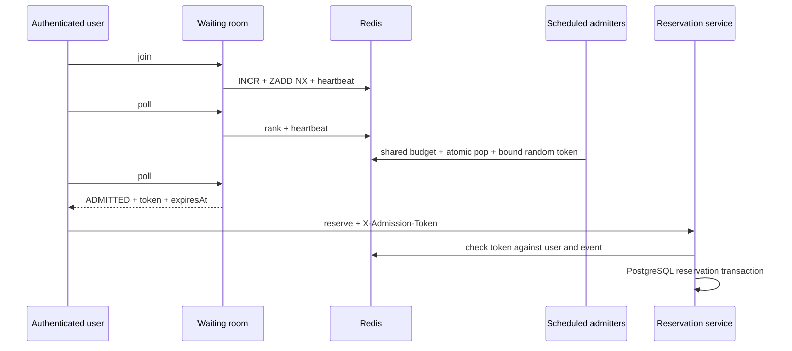

# Redis operations (Week 6)

PostgreSQL is the only durable business authority. Redis contains admission state,
temporary coordination, rate buckets and public read caches. Select the gate with
`RESERVATION_STRATEGY=redis-gate`; the default remains `conditional-update`.
Redis uses AOF, `appendfsync everysec`, a persistent volume and `noeviction`.
AOF may lose approximately the last second after a crash. Reconciliation is required.
This implementation targets a single Redis primary, not Redis Cluster: scripts use
multiple keys without hash tags. Never enable eviction to work around memory pressure.

## Key catalog

All keys start with `ticketrush:{env}:`. `REDIS_ENV` must be unique per deployment.
No permanent counters are used. TTLs below are explicit even for coordination keys.

| Suffix | Type | TTL | Owner / purpose |
|---|---|---|---|
| `inventory:{tier}:available` | string integer | 24 h, refreshed on heal | inventory, admission permits |
| `inventory:{tier}:generation` | string UUID | 24 h, refreshed on heal | inventory, reject old-generation refunds |
| `inventory:{tier}:revision` | string integer | 24 h, refreshed on mutation | inventory, reconciliation CAS |
| `inventory:{tier}:pending` | sorted set | 24 h | inventory, attempt IDs scored by lease deadline |
| `inventory:{attempt}:attempt` | hash | 24 h | inventory, state/quantity/generation; refund deduplication |
| `inventory:{tier}:warm-lock` | string UUID | 5 s | inventory, warm-up single flight; owner-checked release |
| `queue:{event}:waiting` | sorted set | 7 d refreshed on activity | queue, one member per user; INCR score |
| `queue:{event}:heartbeat` | sorted set | 7 d refreshed on activity | queue, Redis-time liveness |
| `queue:{event}:sequence` | string integer | 7 d refreshed on activity | queue, unique order; gaps after leaving are intentional |
| `queue:{event}:opened` | string | 7 d refreshed on activity | queue, lottery executed once |
| `queue:{event}:budget` | string integer | 7 d refreshed on activity | queue, last global admission time in ms |
| `queue:{event}:user:{user}:admission` | JSON string | configurable, default 10 min | queue, 256-bit token bound by user/event key |
| `queue:{event}:user:{user}:seen` | string integer | 7 d | queue, join time and EXPIRED tombstone |
| `rate-limit:{identityHash}:{policy}` | hash | twice refill period | common, token count and Redis timestamp |
| `event:{event-or-page-hash}:cache` | JSON string with generation | random 5–10 s | event, public DTO only |
| `event:{event-or-page-hash}:stale` | same | 30 s | event, stale while another reader rebuilds |
| `event:{event-or-page-hash}:cache-lock` | string UUID | 5 s | event, single flight |
| `event:public:generation` | string integer | 24 h | event, invalidate all public entries on admin changes |

Inventory, rate and cache keys follow the four-part convention directly. Queue
user keys extend the purpose with the user ID so tokens cannot be used across events.
Keys never contain email addresses or raw IPs: limiter identities are SHA-256 hashes.
Admission tokens are returned only to their authenticated owner and never logged.

## Gate and reconciliation

Lua is loaded from resources as `RedisScript` beans. Spring uses EVALSHA with
NOSCRIPT fallback. Gate deduction, attempt registration and compensation are atomic.
Sold-out gate requests do not start a reservation transaction or access PostgreSQL.
Consequently SOLD_OUT can precede validation of sale state or admission token for
an already sold-out tier; no reservation can be created by that path.
An accepted attempt validates the waiting-room token, then uses the original
PostgreSQL conditional UPDATE and reservation/outbox transaction.

An attempt ID belongs to one server-side transaction attempt, not an HTTP retry.
Completion records DONE/REFUNDED; a second compensation is a no-op for 24 h.
A new HTTP request gets a new ID. PostgreSQL still enforces the active-hold constraint.
Cancel, expiry, payment failure, late reacquisition, refund and capacity edits apply
Redis deltas only after the enclosing PostgreSQL transaction commits.

Missing counters use PostgreSQL and attempt a single-flight warm-up afterwards.
Reconciliation computes `total - SUM(HELD) - SUM(CONFIRMED)`, including expired
holds until their PostgreSQL transition actually releases them. It snapshots the
Redis revision before the SQL query and heals only if the revision is unchanged
and no nonexpired gate attempt is pending. `REDIS_ATTEMPT_LEASE` (default 1 minute)
bounds abandoned attempts independently of the 24 h refund-deduplication retention.
An abandoned attempt can delay healing up to that bound; do not delete it manually
while a request could still be running. BUSY/CHANGED means retry on the next run.

Limits: this is not a distributed transaction. FLUSHALL, a process dying after DB
commit, a delayed after-commit delta, or an outage fallback request can create
temporary drift. CAS protects normal in-flight gate attempts, but cannot observe
a PostgreSQL-only transaction during a Redis outage. A later healthy quiescent run
repairs remaining drift. A positive drift can increase PostgreSQL rejections; a
negative drift can reject tickets early. Neither bypasses the DB inventory guard.
An attempt spanning the configured lease can race a heal and cause fresh drift;
set the lease above the deployment's worst-case request/transaction deadline.
PostgreSQL still prevents overselling. An attempt spanning 24 h also exceeds refund
deduplication retention. Recovery heals on the first healthy run after pending leases
expire, rather than waiting for the refund records to expire.

`POST /api/v1/admin/events/{id}/inventory/redis-reconcile` (ADMIN) returns per-tier
`tierId`, `observed` (null if missing/busy), `expected`, and `result`.
The scheduled job runs every `REDIS_RECONCILE_INTERVAL` (default 30 s) when gate mode
is selected. `inventory_drift` is an aggregate absolute pre-healing observation,
not an assertion that all stores are currently synchronized. Mode changes require
a restart; reconcile before switching traffic to an existing Redis namespace.

## Outages and operational settings

Lettuce connection/command timeouts default to 300 ms. The local circuit opens on
the first connectivity/timeout failure, short-circuits for 5 s, and permits one
half-open probe per process. Every fallback is logged and counted. PostgreSQL
sales continue by default; set `REDIS_FALLBACK_ENABLED=false` for gate fail-closed.
Waiting-room operations fail with 503 because local admission would bypass the
global budget. Public cache failures load PostgreSQL directly. An existing waiting
room must recover Redis before token-protected reservations resume; disabled events
continue selling. `FLUSHALL` loses queue positions/tokens; users must rejoin.

`/actuator/info` exposes the configured inventory mode, or `fallback` when the gate
circuit is open. `redis_gate_active` is 1 only for a healthy selected gate. Redis
health can be DOWN while reservation fallback still works; use liveness to determine
process health rather than restarting the app just because Redis is unavailable.

## Waiting room

New events default to disabled (`WAITING_ROOM_DEFAULT=false`). ADMIN can configure
an event using `PUT /api/v1/admin/events/{id}/waiting-room` with
`{"enabled":true,"rate":10,"mode":"fifo"}`. The interval is deployment-wide,
the rate is event-specific. Configure all instances with the same interval/TTL.
FIFO retains join order. Lottery shuffles all live members present at first sale-open
operation atomically; later joiners receive increasing scores behind that cohort.
Do not change ordering mode after sale opening; the opening marker is not reset.

Each join/status is a heartbeat. Default stale threshold is 30 s, suggested polling
is 2 s. Stale entries are removed by queue operations and scheduled admission checks,
including checks paused for sold-out or closed sales; admitted users no longer
require heartbeats. Positions are live ranks, so they move after removal/admission.
EXPIRED is retained for 7 d; afterwards an absent user is NOT_IN_QUEUE. A new join
after expiry creates a new position. Leaving revokes the admission token too.
An admitted token is reusable during its TTL for the same user/event; it is not an
inventory reservation or an order idempotency key.

One Lua call pops at most `rate` users and writes tokens. Redis TIME and the shared
budget allow at most one batch per interval across replicas. There is no catch-up
burst after downtime. Admission pauses before opening, after sale end, and when all
tiers are SOLD_OUT according to PostgreSQL. Status includes `soldOut=true` even
while the state remains WAITING. Pool saturation adaptation is not implemented;
the chosen adaptive signal is event-wide PostgreSQL availability.

## Rate limiting and client addresses

| Policy | Default capacity / full refill | Local outage capacity |
|---|---|---|
| login-ip and login-username | 10 / 1 min each (`app.auth.login-*`) | 3 each |
| register, refresh | 30 / 1 min | 15 |
| reservations, orders | 60 / 1 min, per user | 20 |
| queue-join | 20 / 1 min, per user | 10 |
| queue-status | 120 / 1 min, per user | 30 |
| public event GET | 300 / 1 min, per IP | 100 |

Override declaratively under `ticketrush.rate-limit.policies.<name>`:
`capacity`, `period`, `local-capacity`, `failure` (LOCAL / OPEN / CLOSED).
LOCAL is the default: sales continue with a small process-local safety limit;
login is deliberately stricter. A local fallback is not globally coordinated and
its budget scales with replicas. Local memory is capped at 10,000 identities;
when full it removes expired entries and otherwise rejects unknown identities.
OPEN disables outage protection for that policy; CLOSED rejects during outage.

The security-chain filter executes after JWT authentication. The signed payment
webhook is excluded before any limiter call. Login consumes both an IP bucket and
a normalized-email bucket; rejected IP traffic does not consume the username bucket.
Username throttling can still be abused for temporary account denial; refill is
automatic and there is no persistent account lockout.

Forwarded headers are ignored by default. `TRUSTED_PROXIES` accepts IP/CIDR ranges
of controlled proxies only. If the immediate peer is trusted, X-Forwarded-For is
walked right-to-left, stripping trusted hops; the first untrusted numeric address
is used. Invalid chains fall back to the peer address. The edge must append the real
source address. Do not trust `0.0.0.0/0` or `::/0`. `server.forward-headers-strategy`
stays `none` so another layer cannot rewrite the remote address before this check.

429 uses the common error body plus `Retry-After` (seconds), `X-RateLimit-Limit`,
`X-RateLimit-Remaining`, and `X-RateLimit-Reset` (Unix seconds when fully refilled).
These are token-bucket values, not fixed-window counters. Successful limited
requests also receive limit/remaining/reset headers.

## Cache and metrics

Cache public detail and page zero (all filter variants). Exact inventory is never
serialized into the cache: tiers expose only AVAILABLE/LOW/SOLD_OUT. Admin event
update/publish/cancel and tier edits invalidate a shared generation after commit.
Generation CAS prevents an old rebuild from publishing after invalidation. One
request rebuilds; others use a valid stale entry or wait up to 2 s. After timeout,
they read PostgreSQL; a loader taking longer than the 5 s lease can cause a second
rebuild. This bounded wait favors availability over unlimited request blocking.

Metrics: `reservation_gate_total{result=ok|sold_out|missing|fallback}`,
`redis_fallback_total{feature}`, `redis_compensation_total`, `inventory_drift`,
`inventory_warmup_total`, `redis_gate_active`, `waiting_room_size` (aggregate),
`waiting_room_admitted_total`, `waiting_room_wait_seconds` (histogram),
`rate_limit_rejected_total{policy}`, `cache_hit_total`, `cache_miss_total`.
Aggregate queue size avoids unbounded event-label cardinality. No new broker domain
events are emitted: these Redis optimizations have no downstream consumer.

## Sequence diagrams

```mermaid
sequenceDiagram
  participant U as User
  participant S as Reservation service
  participant R as Redis Lua
  participant P as PostgreSQL
  U->>S: POST reservation
  S->>R: atomic gate(quantity, attempt)
  alt INSUFFICIENT
    S-->>U: 409 SOLD_OUT (no SQL)
  else OK or MISSING or circuit fallback
    S->>P: validate and conditional UPDATE + reservation + outbox
    alt committed
      P-->>S: committed
      S->>R: finish attempt; warm if MISSING
      S-->>U: 201
    else rollback / exception / timeout
      P-->>S: failed
      S->>R: idempotent compensation (only OK attempt)
      S-->>U: controlled error
    end
  end
```



```mermaid
sequenceDiagram
  participant J as Job or ADMIN
  participant R as Redis
  participant P as PostgreSQL
  J->>R: snapshot revision/counter when no pending gate
  J->>P: total minus HELD minus CONFIRMED
  P-->>J: expected quantity
  J->>R: CAS revision and pending set
  alt unchanged and idle
    R->>R: heal counter and generation
    R-->>J: HEALED + observed drift
  else concurrent gate or delta
    R-->>J: BUSY / CHANGED; retry next run
  end
```
