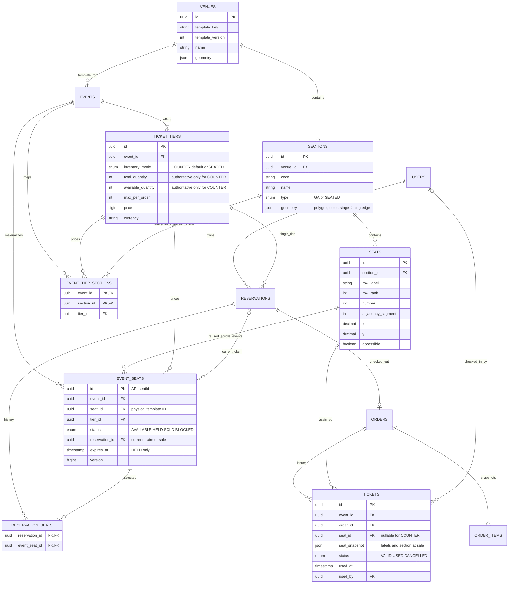

# Proposed hybrid seating data model

Status: design only. No Flyway files are created or existing migrations changed.
All UUIDs below are server-generated. New tables belong to inventory unless noted.



## Keys, ownership and constraints

| Relation / change | Required integrity |
| --- | --- |
| venues | unique(template_key,template_version); published templates immutable |
| sections | unique(venue_id,code); type GA or SEATED; geometry is validated data |
| seats | unique(section_id,row_label,number); positive number; finite bounded coordinates; no physical seats for GA |
| events.venue_id | nullable FK; existing COUNTER events do not require a venue |
| ticket_tiers.inventory_mode | NOT NULL default COUNTER; mode cannot change once published/used |
| event_tier_sections | primary(event_id,section_id); tier belongs to same event; section belongs to event venue; section type agrees with tier mode |
| event_seats | unique(event_id,seat_id); tier belongs to event and to that seat's mapped section; version >= 0 |
| event_seats state | HELD requires reservation_id and expires_at; SOLD requires reservation_id, expires_at null; AVAILABLE/BLOCKED require both null |
| reservation_seats | primary(reservation_id,event_seat_id); historical memberships retained across expiry/refund |
| current claim | event_seats.reservation_id is the single current claim; composite FK (reservation_id,id) -> reservation_seats(reservation_id,event_seat_id), DEFERRABLE INITIALLY DEFERRED, enforces membership at commit |
| reservations | keep non-null tier_id and quantity, one active hold per user+tier; SEATED quantity equals membership count (transaction check + verifier) |
| tickets | nullable seat_id for GA; foreign key (event_id,seat_id) -> event_seats(event_id,seat_id) for SEATED; snapshot labels immutable |
| live ticket uniqueness | unique(event_id,seat_id) WHERE seat_id IS NOT NULL AND status <> 'CANCELLED' |

Cross-table mode/venue consistency cannot be expressed by an ordinary CHECK with
subqueries. Use composite foreign keys where possible and publication/hold service
validation under the event's publication lock for the rest; add direct constraint
tests. Do not pretend a column CHECK enforces the entire topology.
The current-claim FK is deferred to allow a reservation membership row and claim
to be created in the same transaction despite their circular relationship.
Historical membership alone is not an active-seat lock: the event-seat current
claim plus reservation status determine whether it is active.

Indexes: event_seats(event_id,tier_id,status,id), seats(section_id,row_rank,number),
event_seats(reservation_id) WHERE status='HELD', reservation_seats(event_seat_id),
and existing reservations(status,expires_at). Start here; add indexes only from
EXPLAIN/load evidence. Query section states by joining seats.section_id; no new
hot section counter is required. COUNTER inventory columns are not read as
authoritative SEATED totals; derive and expose mode-specific aggregates.

```mermaid
sequenceDiagram
    participant UI as Existing SPA + adapter
    participant API as Reservation service
    participant DB as PostgreSQL
    participant PG as Mock/provider gateway
    UI->>API: POST reservations {seatIds}, admission token
    API->>DB: Validate tier/event and try user-tier lock
    API->>DB: SELECT ordered event seats FOR UPDATE SKIP LOCKED
    alt all seats acquired
        API->>DB: HELD + reservation_seats + outbox (one transaction)
        API-->>UI: 201 reservation, seats, server TTL
    else any unavailable or locked
        API->>DB: ROLLBACK entire hold
        API-->>UI: 409 SEATS_UNAVAILABLE + IDs
    end
    UI->>API: Create order + Idempotency-Key (demo scenario only in demo route)
    API->>DB: Order/payment/outbox transaction
    API->>PG: Initiate after commit
    PG->>API: Signed webhook via existing HTTP handler
    API->>DB: Lock reservation/order/seats; conditional SOLD + tickets + outbox
    UI->>API: GET order until terminal status
    API-->>UI: PAID and issued QR tickets, or failure/expiry/refund state
```

Capacity: physical = available + held + sold + blocked; sellable = physical -
blocked. The published physical topology is fixed; block/unblock changes sellable
capacity. Reconcile compares membership/state/tickets/orders, not just sums.
USED tickets still consume a seat; refund must never make a USED seat available.
